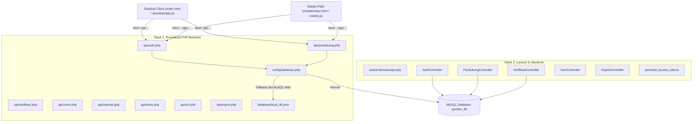

# LAPORAN AUDIT SISTEM: REPOSITORY & ARCHITECTURE MAP
## Sistem Informasi Manajemen Pemenangan Gus Dim (Dapil Kraksaan Raya)

Tanggal Audit: 18 Oktober 2026  
Status Repository: Branch main (Commit 106c5d1)  
Klasifikasi Dokumen: Confidential / Internal Engineering Report  
Versi Dokumen: 1.0.0  

---

### 1. STRUKTUR DAN INVENTARIS DIREKTORI REPOSITORI

Repositori aplikasi berada pada jalur root `E:\Gus Dim`. Berdasarkan analisis struktur direktori, repositori ini memuat implementasi dua tumpukan teknologi (dual-stack) yang berdampingan:

```text
E:\Gus Dim/
├── api/                               # Backend Prosedural PHP (Stack 1)
│   ├── aspirasi.php                   # CRUD & status aspirasi warga + Reverb push
│   ├── auth.php                       # Login, cek token, profil, avatar, ganti password
│   ├── dashboard.php                  # Agregasi data statistik & pemetaan sebaran
│   ├── export.php                     # Unduh berkas rekap CSV konstituen
│   ├── logs.php                       # Pembacaan audit logs aktivitas pengguna
│   ├── ocr.php                        # AI Vision OCR e-KTP berbasis Gemini API
│   ├── pendukung.php                  # Input, update, delete, list pendukung 5 jalur
│   ├── reses.php                      # Manajemen agenda reses, kehadiran, dan pokir
│   ├── users.php                      # Manajemen akun operator, koordinator, admin
│   └── verifikasi.php                 # Alur verifikasi status dan riwayat berjenjang
├── assets/                            # Aset Frontend Desktop Client
│   ├── css/style.css                  # Stylesheet terkompilasi antarmuka desktop
│   ├── icons/                         # Ikon aplikasi dan favicon
│   ├── img/                           # Asset grafis banner, thumbnail wilayah, peta
│   └── js/
│       ├── app.js                     # Logika klien desktop, API adapter, charting (4.351 baris)
│       └── pusher.min.js              # Pustaka klien WebSocket Pusher/Reverb
├── backend/                           # Backend Framework Laravel 11 (Stack 2)
│   ├── app/
│   │   ├── Events/                    # Event PendukungCreated & StatusUpdated
│   │   ├── Http/
│   │   │   ├── Controllers/Api/       # Controller REST API Laravel
│   │   │   └── Middleware/            # CheckMaintenanceMode
│   │   ├── Models/                    # Eloquent Models (User, Pendukung, AuditLog, Wilayah)
│   │   └── Providers/                 # Service Provider Laravel
│   ├── bootstrap/                     # Bootstrap framework & routing
│   ├── config/                        # Konfigurasi Laravel (auth, database, sanctum, dll)
│   ├── database/
│   │   ├── migrations/                # Database migrations Laravel
│   │   └── seeders/                   # Database seeders
│   ├── public/                        # Web root Laravel (index.php, .htaccess)
│   ├── resources/views/               # Blade views (dashboard.blade.php, mobile.blade.php)
│   ├── routes/
│   │   ├── api.php                    # Definisi endpoint API & adapter
│   │   └── web.php                    # Routing antarmuka web & bypass pemeliharaan
│   ├── storage/                       # Cache framework, logs, upload berkas
│   ├── tests/                         # Test directory (ExampleTest bawaan)
│   └── vendor.zip                     # Arsip zip pustaka vendor (36 MB)
├── config/                            # Konfigurasi Backend Prosedural
│   ├── config.php                     # Konstanta database, direktori, Gemini API key
│   ├── database.php                   # Database handler PDO MySQL + Fallback JSON Store
│   └── helpers.php                    # Response helper, auth guard, audit logger, image saver
├── database/                          # Skrip SQL & Database Lokal Root
│   ├── clean_production_data.sql     # Skrip reset database produksi
│   ├── local_db.json                  # Database fallback JSON saat MySQL offline
│   ├── production_clean_schema.sql    # Skema bersih DDL MySQL
│   ├── schema.sql                     # Skema inisial tabel MySQL
│   └── seeds.sql                      # Seed data awal superadmin dan wilayah
├── mobile/                            # Frontend Mobile PWA Khusus Relawan / Korlap
│   ├── assets/                        # CSS, JS, Ikon khusus antarmuka mobile
│   ├── index.html                     # Single Page Application PWA (9.658 baris)
│   ├── manifest.json                  # Web App Manifest PWA
│   └── sw.js                          # Service Worker mobile
├── scripts/                           # Skrip bantu pemeliharaan
├── uploads/                           # Direktori penyimpanan foto wajah & KTP
├── Index.html                         # Entry point antarmuka desktop (2.086 baris)
├── install.php                        # Web installer setup database cPanel
├── JavaScript.html                    # Berkas skrip legacy (GAS polyfill / reference)
├── Style.html                         # Berkas stylesheet inline legacy
├── maintenance.lock                   # Marker mode pemeliharaan
├── sw.js                              # Service worker root
└── cpanel_quick_deploy.sh             # Skrip automasi deployment terminal cPanel
```

---

### 2. DUAL-STACK ARCHITECTURE ANALYSIS

Sistem mengalami divergensi arsitektural (architectural drift) yang signifikan akibat keberadaan dua implementasi backend yang berbeda secara fundamental:



#### Karakteristik Stack 1 (PHP Prosedural di root `/api/`):
- Berkas berupa script PHP tunggal per domain (`api/pendukung.php`, `api/auth.php`, dll).
- Otentikasi menggunakan tabel kustom `user_tokens` dengan token hexadecimal 64 karakter.
- Kolom password pada tabel `users` mengandalkan kolom `password_hash`.
- Memiliki fallback otomatis ke `database/local_db.json` jika koneksi PDO gagal.
- Menyediakan seluruh fitur bisnis (Pendukung, Verifikasi, Pengguna, Log, OCR, Ekspor, Aspirasi, Reses & Pokir).

#### Karakteristik Stack 2 (Laravel 11 di folder `/backend/`):
- Menggunakan arsitektur MVC berbasis Laravel 11 dengan dependency injection dan Eloquent ORM.
- Otentikasi menggunakan Laravel Sanctum pada tabel `personal_access_tokens`.
- Kolom password pada tabel `users` mengandalkan kolom standar `password` (terenkripsi bcrypt).
- Tidak memiliki model atau rute untuk Aspirasi, Reses Titik, Kehadiran Reses, Pokir, maupun OCR KTP.
- Menggunakan middleware global `CheckMaintenanceMode` dan rute bypass `/maintenance-bypass`.

---

### 3. MATRIKS PARITAS FITUR ANTARA KEDUA STACK BACKEND

Perbandingan mendalam antara implementasi API PHP Prosedural dan Controller Laravel 11 menunjukkan ketimpangan paritas fungsi yang substansial:

| Modul / Endpoint | PHP Prosedural (`api/*.php`) | Laravel 11 (`backend/...`) | Status Paritas & Catatan Masalah |
| :--- | :--- | :--- | :--- |
| Login Pengguna | `api/auth.php?action=login` | `/api/auth/login` | **MISMATCH**: Laravel memakai `password`, PHP memakai `password_hash`. Token Sanctum vs token hex kustom. |
| Backdoor Otentikasi | Ada (baris 51-55) | Tidak Ada | **INCONSISTENCY**: Backdoor hanya terdapat di PHP prosedural. |
| Input Pendukung | `api/pendukung.php?action=submit` | `/api/pendukung` (POST) | **DRIFT**: PHP mengizinkan klien memilih status (`Final`), Laravel memaksa status `Diinput`. |
| Cek NIK Duplikat | `api/pendukung.php?action=check-nik`| `/api/pendukung/check-nik` | **PARITY SEBAGIAN**: Format response identik. |
| Update Pendukung | `api/pendukung.php?action=update` | Tidak Ada / Adapter Parsial | **MISSING**: Controller Laravel tidak memiliki method update pendukung terpisah yang lengkap. |
| Hapus Pendukung | `api/pendukung.php?action=delete` | Tidak Ada | **MISSING**: Fitur penghapusan pendukung belum diimplementasikan di Laravel. |
| Riwayat Verifikasi | `api/verifikasi.php?action=riwayat`| `/api/verifikasi/riwayat` | **PARITY SEBAGIAN**: Response identik, namun filter teritorial berbeda. |
| Update Status Verif | `api/verifikasi.php?action=update-status`| `/api/verifikasi/status` | **SECURITY GAP**: PHP memiliki territorial guard, Laravel TIDAK memiliki territorial guard sama sekali. |
| Modul Aspirasi | `api/aspirasi.php` (List, Add, Status)| Tidak Ada | **MISSING**: Sama sekali belum dibuat di Laravel. |
| Modul Reses & Pokir| `api/reses.php` (Titik, Hadir, Pokir) | Tidak Ada | **MISSING**: Sama sekali belum dibuat di Laravel. |
| OCR AI e-KTP | `api/ocr.php` (Gemini Vision AI) | Tidak Ada | **MISSING**: Belum diintegrasikan ke Laravel service. |
| Ekspor Data CSV | `api/export.php` | `/api/export` & `/api/export-public` | **CRITICAL GAP**: Laravel mengekspos rute public tanpa otentikasi. |
| Jadikan Operator | `api/users.php?action=create-from-pendukung`| Tidak Ada | **MISSING**: Fitur otomasi pembuatan user dari data pendukung hanya ada di PHP. |

---

### 4. ANALISIS DEPENDENSI SISTEM

#### A. Backend Dependencies (Composer / PHP)
Berdasarkan berkas `backend/composer.json`:
- **PHP Runtime Required**: `^8.2`
- **Framework Core**: `laravel/framework: ^11.31`
- **Otentikasi API**: `laravel/sanctum: ^4.0`
- **WebSocket Server**: `laravel/reverb: ^1.0`
- **Testing Engine**: `phpunit/phpunit: ^11.0.1`

*Temuan Masalah*: Repositori memuat berkas binary `backend/vendor.zip` sebesar 36 MB yang di-commit ke Git. Hal ini melanggar best practice manajemen repositori Git dan menyebabkan ukuran klon repositori membengkak secara tidak perlu.

#### B. Frontend Dependencies (NPM & CDN)
Aplikasi desktop dan mobile memuat pustaka pihak ketiga melalui CDN publik:
- **Leaflet.js** (v1.9.4): Visualisasi peta spasial koordinat pendukung (OpenStreetMap basemap).
- **Chart.js** (v4.x): Rendering diagram cincin total pendukung dan grafik batang jalur perolehan.
- **Tesseract.js** (v5.x): OCR cadangan sisi browser.
- **Pusher JS Client** (v8.x): Koneksi WebSocket real-time ke Laravel Reverb.
- **Google Fonts CDN**: Font Plus Jakarta Sans, Poppins, dan Inter.

*Risiko*: Ketergantungan pada CDN eksternal tanpa mekanisme Subresource Integrity (SRI) membuka peluang kompromi keamanan rantai pasok (Supply Chain Attack) apabila salah satu penyedia CDN mengalami insiden keamanan.

---

### 5. ENTRY POINTS DAN SIKLUS REQUEST (LIFECYCLE)

#### Siklus Request 1: Klien Menghubungi PHP Prosedural (Default Produksi cPanel)
1. Permintaan masuk ke web server Apache melalui `public_html/api/[nama_modul].php`.
2. File `api/[nama_modul].php` memuat `config/helpers.php`.
3. `config/helpers.php` memuat `config/config.php` dan `config/database.php`.
4. Header CORS diset wildcard (`Access-Control-Allow-Origin: *`).
5. Pemeriksaan file `maintenance.lock` dijalankan. Jika aktif, request diblokir (kecuali parameter `bypass=gusdim2025` disertakan).
6. Otentikasi diperiksa via header `Authorization: Bearer [token]`. Token dicari pada tabel `user_tokens` di MySQL atau array `tokens` di `local_db.json`.
7. Logika bisnis dijalankan, query SQL dieksekusi, audit log dicatat, dan JSON dikembalikan.

#### Siklus Request 2: Klien Menghubungi Laravel Backend (Jika diarahkan ke `backend/public/index.php`)
1. Permintaan masuk ke `backend/public/index.php`.
2. Laravel HTTP Kernel me-load autoloader Composer dan bootstrapping framework.
3. Request melewati pipeline Middleware global (`CheckMaintenanceMode`).
4. Jika path dimulai dengan `/api/`, Sanctum middleware memvalidasi token bearer dari tabel `personal_access_tokens`.
5. Rute yang sesuai pada `routes/api.php` memanggil Controller yang bersangkutan.
6. Controller mengeksekusi Eloquent Model dan mengembalikan JSON Response standar Laravel.

---

### 6. EVALUASI MODEL DEPLOYMENT & ARSITEKTUR FISIK

Arsitektur saat ini dirancang untuk berjalan di lingkungan Shared Hosting cPanel atau VPS dengan spesifikasi:
- Web Server: Apache 2.4 dengan modul `mod_rewrite`, `mod_headers`, `mod_deflate`, dan `mod_expires`.
- PHP Engine: PHP 8.2 - 8.4 (ea-php84 atau alt-php84).
- Database Engine: MySQL 8.0 atau MariaDB 10.6+.

Terdapat kontradiksi mendasar dalam strategi deployment: skrip `cpanel_quick_deploy.sh` mencoba mempublikasikan Laravel `backend/public` ke `public_html`, namun kode JavaScript sisi klien (`assets/js/app.js` dan `mobile/index.html`) tetap memanggil endpoint root `/api/*.php`. Akibatnya, pada konfigurasi tertentu, permintaan API gagal atau terjadi kebingungan routing antara file `.php` fisik dan rute Laravel virtual.
